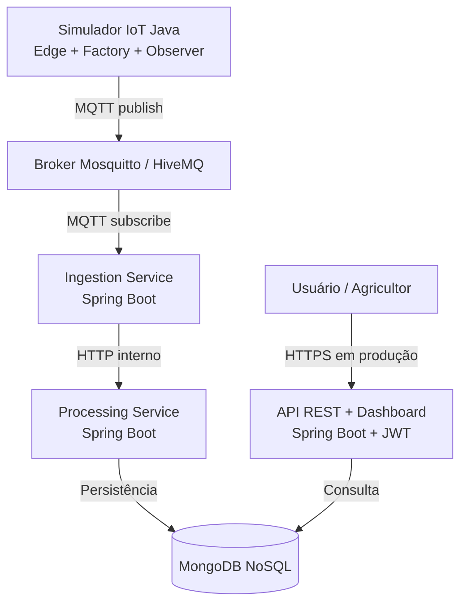

# Arquitetura AgroMonitor IoT

## Visão de contexto

O agricultor consulta o painel web para acompanhar sensores instalados em uma fazenda. O simulador representa dispositivos IoT e publica telemetria em MQTT.

## Contêineres (C4 simplificado)

## Decisões

- MQTT foi escolhido para telemetria leve e desacoplada.
- Serviços de ingestão, processamento e consulta são processos separados.
- MongoDB armazena documentos de leituras com atributos variáveis.
- Edge executa uma regra inicial no produtor para sinalizar valores críticos antes da nuvem.
- API aplica JWT nas rotas de consulta.
- Factory cria leituras tipadas; Observer reage a alertas identificados localmente.

## Limites e evolução

O broker local está sem autenticação e TLS por simplicidade acadêmica; isso não é configuração segura para internet. O endpoint interno de processamento também depende de isolamento de rede. Para produção, adicionar autenticação entre serviços, ACL/TLS MQTT, idempotência, retentativas com fila de mensagens mortas, observabilidade e autorização por fazenda.
